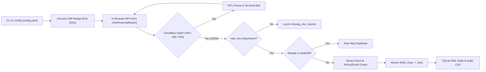
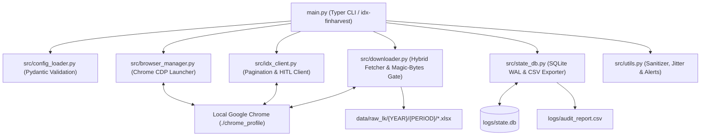

# IDX FinHarvest (`idx-finharvest`)

[](https://www.python.org/downloads/)
[](LICENSE)
[](https://github.com/astral-sh/ruff)

**IDX FinHarvest** is a command-line harvester that downloads standardized Excel financial statements (`FinancialStatement*.xlsx`) for all listed companies (*emiten*) on the **Indonesia Stock Exchange (IDX / Bursa Efek Indonesia)** across multi-year and quarterly reporting periods (`TW1`, `TW2`, `TW3`, and `FY` audited reports).

---

## Why IDX FinHarvest?

Direct HTTP scrapers (`requests`, `curl`, headless browsers) frequently fail on the IDX portal because Cloudflare challenges block automated TLS fingerprints and often return HTML challenge pages disguised with `.xlsx` filenames.

**IDX FinHarvest** solves this through a deterministic, verifiable pipeline:

1. **Chrome DevTools Protocol (CDP) Session Bridge**: Connects Playwright directly to a real local Google Chrome process (`--remote-debugging-port=9222`), inheriting genuine browser TLS fingerprints and session cookies (`cf_clearance`).
2. **In-Browser API Execution**: Queries the internal `GetFinancialReport` endpoint via `window.fetch()` inside the active IDX origin tab.
3. **Pre-Flight Pagination Detection**: Automatically probes the endpoint at startup to detect whether `indexFrom` operates in `page_1_based`, `page_0_based`, or row `offset` mode.
4. **Magic-Bytes & Size Integrity Gate**: Validates every downloaded payload against the OpenXML ZIP header (`b"PK\x03\x04"`) and a minimum size threshold (`> 1024 bytes`). HTML error or captcha pages are rejected before touching your dataset.
5. **Atomic File Writes**: Streams payloads to a `.tmp` file first and executes `os.replace()` only after binary verification succeeds, preventing partial or corrupted files on Ctrl+C interrupts.
6. **SQLite WAL State & Missing-XLSX Audit**: Tracks every download in `logs/state.db` (`SUCCESS`, `FAILED`, `SKIPPED_CORRUPT`) for instant resume/auto-skip, and logs issuers that published filings without an Excel attachment in `missing_xlsx_reports`.
7. **Human-in-the-Loop (HITL) Pause & Resume**: If a Cloudflare Turnstile challenge appears mid-run (`HTTP 403/429/503`), the harvester alerts the terminal, waits for you to clear the tab in Chrome, and resumes from the exact pagination cursor.

---

## Visual End-to-End Pipeline



---

## System Architecture & Module Map



---

## Project Structure

```text
idx-finharvest/
├── .github/
│   └── workflows/
│       └── ci.yml              # GitHub Actions CI across Ubuntu & Windows (Python 3.10-3.12)
├── data/
│   └── raw_lk/
│       └── .gitkeep            # Preserves structured output directory for harvested .xlsx files
├── logs/
│   └── .gitkeep                # Preserves runtime directory for state.db, scraper.log & audit CSV
├── src/
│   ├── __init__.py             # Package version and metadata
│   ├── browser_manager.py      # Cross-platform Chrome executable detector & CDP connector
│   ├── config_loader.py        # Pydantic schema validation & directory bootstrapper
│   ├── downloader.py           # Hybrid binary fetcher, magic-bytes validator & atomic writer
│   ├── idx_client.py           # In-browser API client, pagination detector & HITL loop
│   ├── state_db.py             # SQLite WAL state persistence & CSV audit exporter
│   └── utils.py                # Cross-OS filename sanitizer, jitter pacing & terminal alerts
├── tests/
│   └── test_harvester.py       # Unit tests for config, sanitization, binary validation & SQLite state
├── .gitignore                  # Strict exclusion of datasets, Chrome profile, logs & SQLite databases
├── config.yaml                 # Active runtime configuration
├── config.example.yaml         # Reference configuration template
├── main.py                     # Typer CLI application
├── pyproject.toml              # PEP 621 package configuration & `idx-finharvest` console script
├── requirements.txt            # Runtime dependencies
├── LICENSE                     # MIT License
└── README.md                   # Documentation
```

---

## Requirements & Installation

### Prerequisites
- **Python 3.10+** (tested on Python 3.10, 3.11, and 3.12 across Windows, macOS, and Linux).
- **Google Chrome** or **Chromium** installed on your system.

### 1. Clone & Install Dependencies

```bash
git clone https://github.com/your-username/idx-finharvest.git
cd idx-finharvest

# Create and activate a virtual environment (recommended)
python -m venv .venv
# Windows PowerShell:
.\.venv\Scripts\Activate.ps1
# Linux / macOS:
source .venv/bin/activate

# Install dependencies
pip install -r requirements.txt

# Optional: install as an editable CLI package (`idx-finharvest` command)
pip install -e .
```

---

## Quick Start (2-Step Workflow)

### Step 1: Launch Chrome with CDP Debugging

```bash
python main.py launch-browser
# Or if installed via pip install -e .:
idx-finharvest launch-browser
```

This launches an isolated Google Chrome profile (`./chrome_profile`) listening on local port `9222` and opens the IDX financial reporting page. If Cloudflare displays a verification checkbox, complete it once in that Chrome window.

### Step 2: Run the Harvester

```bash
python main.py harvest
```

#### Common CLI Filtering Options

- **Download specific years:**
  ```bash
  python main.py harvest --years 2023,2024
  ```
- **Download specific periods (`tw1`, `tw2`, `tw3`, `audit`):**
  ```bash
  python main.py harvest --periods tw1,tw2,tw3,audit
  ```
- **Target specific stock tickers (fast test run):**
  ```bash
  python main.py harvest --ticker BBCA,BMRI,TLKM,ASII --years 2024 --periods tw1
  ```

---

## Auditing & Recovery Commands

### Inspect Progress & Export Audit CSV

View a terminal summary broken down by year and reporting period, and export the full download ledger to `./logs/audit_report.csv`:

```bash
python main.py status
```

### Retry Failed Downloads

Re-attempt only records marked as `FAILED` in `logs/state.db` (optionally filtered by ticker):

```bash
python main.py retry-failed
python main.py retry-failed --ticker TLKM
```

---

## Output Directory & Naming Convention

Downloaded files are organized deterministically by year and period label (`TW1`, `TW2`, `TW3`, `FY`):

```text
data/raw_lk/
├── 2023/
│   └── FY/
│       └── TLKM_2023_FY_FinancialStatement-2023-Tahunan-TLKM.xlsx
└── 2024/
    └── TW1/
        └── BBCA_2024_TW1_FinancialStatement-2024-I-BBCA.xlsx
```

- **Path pattern:** `./data/raw_lk/{YEAR}/{PERIOD_LABEL}/{TICKER}_{YEAR}_{PERIOD_LABEL}_{SANITIZED_ORIGINAL_NAME}.xlsx`
- Illegal filesystem characters (`<>:"/\|?*`, ASCII control codes) and Windows reserved device names (`CON`, `PRN`, `AUX`, `NUL`, `COM1`–`COM9`, `LPT1`–`LPT9`) are sanitized automatically.

---

## Configuration (`config.yaml`)

Customize target years, periods, CDP settings, and rate-limit jitter in `config.yaml` (or copy from `config.example.yaml`):

```yaml
years: [2022, 2023, 2024, 2025, 2026]
periods: [tw1, tw2, tw3, audit]

period_mapping:
  tw1: TW1
  tw2: TW2
  tw3: TW3
  audit: FY

cdp:
  host: "localhost"
  port: 9222
  user_data_dir: "./chrome_profile"
  chrome_path: ""  # Auto-detected if left empty

delays:
  file_download_min: 1.5
  file_download_max: 3.5
  page_request_min: 2.0
  page_request_max: 4.5
```

---

## Running Tests

Run the unit test suite (covers configuration loading, cross-platform filename sanitization, magic-bytes verification, HTML challenge rejection, URL encoding, and SQLite WAL state management):

```bash
python -m unittest discover -s tests -p "test_*.py" -v
```

---

## License

Released under the [MIT License](LICENSE).
